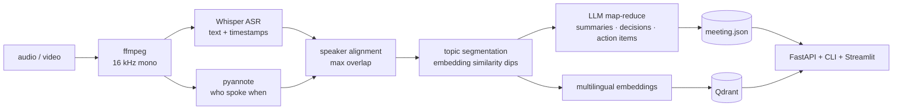

# 🎙️ AI Meeting Intelligence

[](https://github.com/dvct1n/meeting-intelligence/actions/workflows/ci.yml)

[](https://github.com/dvct1n/meeting-intelligence/actions/workflows/security.yml)

[](LICENSE)

Turns long-form meeting recordings into **structured, searchable knowledge**: who said what, what was decided, who owns which action item and by when, plus semantic search across all past meetings. Works with Vietnamese and other languages Whisper supports.

🔗 [GitHub repository](https://github.com/dvct1n/meeting-intelligence) · ▶️ `make demo` · 📄 [Sample report](examples/sample_report.md) (synthetic) · 🧪 [Offline synthetic evaluation](docs/evaluation.md#1-offline-synthetic-demonstration) · 🇻🇳 [Tiếng Việt](README.vi.md) · 🏗️ [Architecture](docs/architecture.md) · 📏 [Evaluation](docs/evaluation.md)

## How it works



| Stage               | Tech                                                                        |
| ------------------- | --------------------------------------------------------------------------- |
| Speech recognition  | Whisper via Hugging Face Transformers (PyTorch)                             |
| Speaker diarization | `pyannote.audio`                                                            |
| Segmentation        | utterance embeddings + local-minimum similarity dips, with hard size limits |
| Analysis            | any OpenAI-compatible LLM (OpenAI, Ollama, vLLM, Groq…) or Anthropic        |
| Search              | `multilingual-e5-small` embeddings + Qdrant (embedded mode or server)       |
| Serving             | FastAPI (background processing), `meeting-intel` CLI, Streamlit UI          |

## Quick start

**Prerequisites:** Python 3.10+, `ffmpeg`. A GPU is recommended; CPU works, slowly.

```bash
python -m venv .venv && source .venv/bin/activate
pip install -e ".[all]"          # API + UI + Whisper/pyannote/embeddings (large download)
cp .env.example .env             # configure your LLM; HF_TOKEN is needed only when diarization is enabled
```

**Diarization access (one-time):** accept the terms for
[`pyannote/speaker-diarization-3.1`](https://huggingface.co/pyannote/speaker-diarization-3.1) and
[`pyannote/segmentation-3.0`](https://huggingface.co/pyannote/segmentation-3.0), then put a Hugging Face token in `HF_TOKEN`.
No token? Set `DIARIZE=false` and everything is attributed to one speaker.

**LLM:** OpenAI (`LLM_API_KEY`), a local model through Ollama (`LLM_BASE_URL=http://localhost:11434/v1`), or Anthropic (`LLM_PROVIDER=anthropic`). See [`.env.example`](.env.example) for every setting.

### Use it from the command line

```bash
meeting-intel process standup.mp3 -o report.md     # transcribe → analyse → index → Markdown report
meeting-intel list
meeting-intel show <id>
meeting-intel search "what did we decide about the release date?"
```

### …or as a service

```bash
uvicorn meeting_intel.api:app --reload             # API → http://localhost:8000/docs
streamlit run ui/streamlit_app.py                  # UI  → http://localhost:8501
```

Or with Docker: `docker compose up --build` (add `--profile qdrant` and set `QDRANT_URL=http://qdrant:6333` in `.env` for a standalone Qdrant server). Docker services run as a non-root user, use read-only container filesystems where practical, and bind published ports to localhost.

> Only want to hack on the code or run the tests? `pip install -e ".[dev]"` is enough — no models are downloaded; the tests use fakes.

### Offline demo (no recordings, model downloads, or API keys)

You can explore the sample workflow without access to private meeting recordings or paid services. Install the lightweight development dependencies first (`pip install -e ".[dev]"`), then run:

```bash
make demo
# equivalent: python scripts/run_demo.py
```

The demo schema-validates a synthetic meeting fixture, displays its precomputed summary/decisions/action items, performs a transparent keyword-overlap search, and exports `artifacts/demo-report.md`. It is an offline product walkthrough, **not** a run of the ML inference pipeline: it does not call Whisper, pyannote, an LLM, neural embeddings, or Qdrant.

To exercise the metric implementations separately, run `make synthetic-eval` (or `python scripts/run_synthetic_evaluation.py`). That script uses hand-written transcript/action-item examples and hand-crafted retrieval rankings. Its values demonstrate metric calculations only and are not evidence of model quality. Real audio processing still requires recordings you are permitted to use, the optional ML dependencies, and configured LLM / Hugging Face access where applicable.

## API

Interactive docs at `/docs`. If `API_KEY` is set, send it as `X-API-Key` (every route except `/health`).

| Method   | Path                    | Description                                                                                                                               |
| -------- | ----------------------- | ----------------------------------------------------------------------------------------------------------------------------------------- |
| `GET`    | `/health`               | Liveness probe                                                                                                                            |
| `POST`   | `/meetings`             | Upload a recording (multipart `file`). Returns `202`; processing runs in the background. `400` bad type/empty, `413` over `MAX_UPLOAD_MB` |
| `GET`    | `/meetings`             | List meetings with status and analysis                                                                                                    |
| `GET`    | `/meetings/{id}`        | Full transcript, chunks and analysis                                                                                                      |
| `GET`    | `/meetings/{id}/export` | The whole meeting as a Markdown report                                                                                                    |
| `DELETE` | `/meetings/{id}`        | Remove a meeting and its vectors (`409` while it is still processing)                                                                     |
| `POST`   | `/search`               | `{"query": "...", "meeting_id": null, "limit": 5}` → semantic search                                                                      |

```bash
curl -F "file=@standup.mp3" http://localhost:8000/meetings
curl -X POST http://localhost:8000/search -H "Content-Type: application/json" \
     -d '{"query": "what did we decide about the release date?"}'
```

## Design notes

- **Speaker alignment:** each ASR segment is assigned the speaker whose diarization turns overlap it most; short pauses between the same speaker are merged.
- **Segmentation:** a similarity dip between the averaged embeddings of the surrounding utterances marks a topic change (only local minima are kept); size limits guarantee every chunk fits an LLM prompt.
- **Map-reduce analysis:** chunks are summarized and mined for decisions/action items independently, then merged and de-duplicated, so long meetings never exceed the context window. The LLM is told to extract only what is explicitly stated and to return `null` for unknown owners/deadlines.
- **Fail-soft:** if diarization fails the pipeline continues with one speaker; a failed job stores its error in `meeting.json`; jobs interrupted by a restart are marked failed on start-up; LLM calls are retried with back-off.
- **Testability:** heavy models are injected, so the whole pipeline, API and CLI are tested offline with fakes in about a second.

More detail in [docs/architecture.md](docs/architecture.md).

## Development

```bash
pip install -e ".[dev]"
make check          # ruff + mypy + pytest (what CI runs)
make demo           # offline sample workflow; writes artifacts/demo-report.md
make synthetic-eval # synthetic metric calculations only
```

See [CONTRIBUTING.md](CONTRIBUTING.md), [reproducibility notes](docs/reproducibility.md), and the [release checklist](docs/github_release_checklist.md). The repository includes tools for WER, Recall@k and action-item precision/recall; **real model-performance results have not yet been measured**. See [docs/evaluation.md](docs/evaluation.md) for the clearly labeled synthetic demo and the real evaluation protocol.

## Privacy & security

Meeting recordings are sensitive. Audio, transcripts and vectors stay in your configured storage (`DATA_DIR`); transcript text is sent to the LLM provider you configure — use a local model (Ollama/vLLM) to keep meeting content on-premise. Make sure everyone on a recording has consented to it. The API does not enforce authentication unless `API_KEY` is set, and it has no user accounts or per-meeting permissions. Docker Compose binds its ports to localhost by default; before any network exposure, configure a strong `API_KEY`, HTTPS, a reverse proxy and appropriate access controls. Never commit `.env`, credentials, recordings or private transcripts. See the [GitHub release checklist](docs/github_release_checklist.md) and [security policy](SECURITY.md) and [citation metadata](CITATION.cff).

## Limitations

- Overlapping speech is attributed to a single speaker.
- Speaker labels are anonymous (`Speaker 1…`); names only appear if said aloud.
- Quality depends on the chosen Whisper size and the LLM; very noisy audio degrades every stage.
- One recording is processed at a time (the heavy stages share the GPU); there is no job queue, so a restart drops running jobs.
- Meetings are stored as JSON files and are not meant for multi-user or very large archives.

## Project layout

```
meeting_intel/   asr · diarize · align · segment · analyze · index · pipeline · api · cli · export · metrics
ui/              Streamlit app
tests/           offline unit + API tests (fakes in tests/fakes.py)
docs/            architecture, evaluation, reproducibility, release checklist
examples/        synthetic sample meeting/report and metric fixtures
scripts/         offline sample demo + synthetic-evaluation runner
```

## License

[MIT](LICENSE) · Citation metadata: [CITATION.cff](CITATION.cff)
