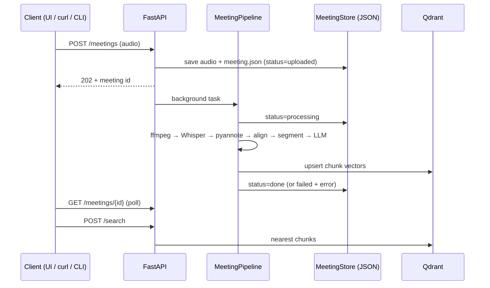

# Architecture

## Data flow

## Modules

| Module | Responsibility |
|---|---|
| `audio` | any media → 16 kHz mono WAV via ffmpeg |
| `asr` | Whisper through Hugging Face `pipeline`, 30 s windows, timestamps |
| `diarize` | pyannote "who spoke when" (supports pyannote 3.x and 4.x APIs) |
| `align` | ASR segments × speaker turns → utterances (max overlap), merge short pauses, anonymous labels |
| `segment` | TextTiling-style topic boundaries on utterance embeddings + size limits |
| `analyze` | map-reduce LLM analysis: chunk summaries, decisions, action items, overview, per-speaker summaries |
| `llm` | thin OpenAI-compatible / Anthropic client with retries and tolerant JSON parsing |
| `embed`, `index` | multilingual-e5 embeddings, Qdrant collection (embedded or server) |
| `storage` | one folder per meeting (`audio.*`, `meeting.json`), validated ids, atomic writes |
| `pipeline` | orchestration; heavy steps are injected so they can be faked |
| `api`, `cli`, `ui/` | the three front-ends over the same `Services` |
| `export`, `metrics` | Markdown report; WER / Recall@k / action-item P-R-F1 |

## Key decisions

- **Dependency injection for models.** `MeetingPipeline` takes `audio_fn`, `asr_fn` and `diarize_fn`, and the LLM, embedder and index are protocols. The test-suite runs the whole pipeline in about a second without a GPU, network or model download, and CI installs only the light core.
- **Map-reduce over the transcript.** Chunks are analysed independently and merged, so cost grows linearly and no prompt exceeds the context window regardless of meeting length.
- **Extraction, not generation.** Prompts require items to be explicitly stated and allow `null` owners/deadlines, trading recall for fewer hallucinated commitments. Measure the trade-off with `meeting-intel eval-items`.
- **Fail-soft stages.** Diarization failure degrades to one speaker; LLM calls retry; a malformed extraction for one chunk only drops that chunk's items.
- **Plain files for storage.** One JSON file per meeting keeps the project dependency-free and inspectable. The `MeetingStore` interface is small enough to replace with a database.

## Scaling notes

The pipeline lock serialises GPU work inside one process, and jobs run in FastAPI background tasks. To scale beyond a single machine, move `MeetingPipeline.process` behind a queue (Celery/RQ/Arq), run workers with GPUs, use a Qdrant server (`QDRANT_URL`) and replace `MeetingStore` with shared storage.
